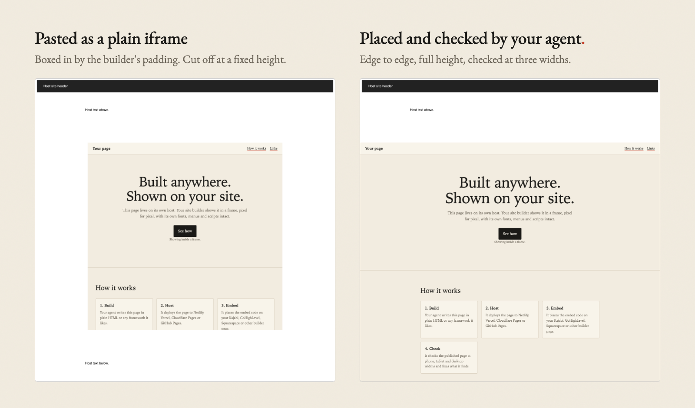

  <picture>
    <source media="(prefers-color-scheme: dark)" srcset="assets/banner-night.png">
    
  </picture>

Your AI agent builds a page, or takes one you already have, hosts it, and puts it on the site builder you already use: Kajabi, GoHighLevel, Squarespace, WordPress, Webflow, Shopify, Wix or anything that accepts custom code. Then it opens the published page at phone, tablet and desktop widths and fixes what it finds. You answer a few questions and approve the publish. You never copy or paste code.

  <picture>
    <source media="(prefers-color-scheme: dark)" srcset="assets/before-after-night.png">
    
  </picture>

Site builders make custom design hard. Their themes override your fonts, their sections add padding, and their editors strip your scripts. Embed Anywhere hosts the page on its own (Netlify, Vercel, Cloudflare or GitHub Pages) and shows it on your site in a frame. Visitors stay on your domain and see the page exactly as it was built.

| If you are | Start with |
|---|---|
| A person who wants a page on their site | [Use it](#use-it): give your agent this repository and the job |
| An AI agent asked to put a page on someone's site | [AGENTS.md](AGENTS.md) |
| An AI agent asked to change this project | [AGENTS.md, "Working on the code"](AGENTS.md#working-on-the-code) |

## Use it

Give your agent this repository and the job, in your own words:

> Use github.com/Gatori-ai/embed-anywhere. Build me a sales page for my coaching program and put it on my Kajabi site at /coaching.

Already have the page? Point at it:

> Use github.com/Gatori-ai/embed-anywhere. Put ~/Downloads/launch.html on my Squarespace site at /launch.

> Use github.com/Gatori-ai/embed-anywhere. Embed https://my-app.vercel.app on my GoHighLevel funnel, full screen.

A page made somewhere else keeps its design. The agent adds one small script and the header that lets your builder show it, or embeds a live page as it is when it can.

Claude Code, Codex, Cursor or any agent that can run commands follows [AGENTS.md](AGENTS.md). It works through what you already have connected: the builder's MCP or API, your signed-in browser (for example Claude in Chrome), or computer use. If it is missing a connection, it asks you to sign in once. It never asks you to copy or paste code.

What the agent does:

1. Checks which hosting accounts and builder connections it can use.
2. Asks what the page says and where it goes.
3. Builds the page from [`starter/`](starter/), or prepares the one you have.
4. Deploys it and checks your builder will be allowed to show it.
5. Places the embed code on your builder page and publishes (asking you first if you did not already say to).
6. Opens the published page at phone, tablet and desktop widths, finds anything off (gaps at the edges, a section that refuses full width, a sideways scrollbar, a page cut off at the bottom), fixes it in the builder and checks again until every width passes.

## Builders

| Builder | Status | How the agent places the code |
|---|---|---|
| Kajabi | Tested on live sites | Kajabi MCP, or your browser |
| GoHighLevel | Tested on live sites | Your browser (GoHighLevel has no API that writes pages) |
| Squarespace | Tested on live sites | Your browser |
| WordPress | Untested | REST API, or your browser |
| Webflow | Untested | Data API custom code, or your browser |
| Shopify | Untested | Admin API theme template, or your browser |
| Wix | Untested | Your browser |
| Anything with custom code | Untested | Whatever channel it offers |

Each builder has a playbook in [`playbooks/`](playbooks/). Untested playbooks come from each builder's documentation; the verify step catches what they miss. Ran it on a builder? Open an issue or pull request with what you found.

## Three ways to show a page

| Mode | What visitors see | Good for |
|---|---|---|
| Full screen | Your page fills the browser window and scrolls inside the frame. Its sticky menus keep working. | Landing pages, sales pages |
| Fits its content | A band across the page that grows to your page's height. | A custom section in an existing page |
| Fixed height | A box of a set height. | Calculators, forms, widgets |

## What is in here

| Path | For |
|---|---|
| [AGENTS.md](AGENTS.md) | The runbook the agent follows |
| [`playbooks/`](playbooks/) | Placing the code in each builder, and hosting the page |
| [`starter/`](starter/) | The page the agent builds from, with Netlify and Vercel configs |
| [`embed/frame.js`](embed/frame.js) | Goes on the hosted page: link handling and height reporting |
| [`embed/inspect.js`](embed/inspect.js) | Measures an embed on any page; agents run it in a browser tool |
| `bin/` | `prepare-page` (readies a page you already have), `embed-snippet` (builds the code), `check-embed` (can this page be framed), `verify-embed` (checks the published page at three widths) |
| `assets/` | Banners and the before and after image. Sources in [Gatori-ai/.github/brand](https://github.com/Gatori-ai/.github/tree/main/brand) |
| `scripts/selftest.mjs` | `npm run selftest`: proves the checks work on this machine against sample pages built like a messy site builder |

Needs Node 20 or later and Google Chrome (or Chromium) for the verify step.

## Trade-offs

- Search engines index the builder's page, and your content sits inside the frame. Pages that depend on organic search do better built natively. The agent sets the builder page's title, description and share image, because link previews read those.
- Full screen pages scroll inside the frame.
- Payment and booking providers often refuse to run inside another site's frame, so checkout links open in the whole window.

## License

MIT.
